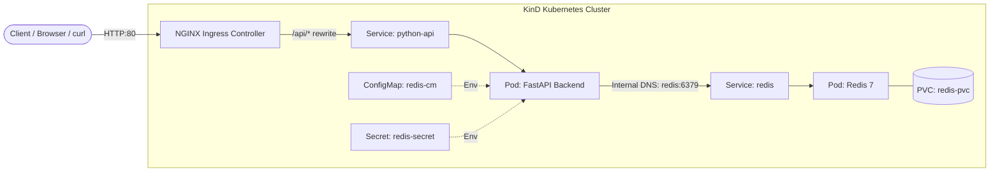

# 🚀 Kubernetes FastAPI & Redis Microservice Lab

A production-ready reference architecture and hands-on lab demonstrating containerization, declarative Kubernetes deployment, and Helm chart packaging for a **FastAPI** backend with a persistent **Redis** caching tier.

---

## 📌 Features

- **FastAPI Backend**: Lightweight asynchronous REST API for key-value caching and health inspection.
- **Redis Cache Layer**: Containerized Redis 7 deployment backed by a PersistentVolumeClaim (PVC).
- **Dual Deployment Paradigms**:
  - **Raw Kubernetes Manifests (`k8s/`)**: Declarative ConfigMaps, Secrets, Deployments, Services, and Ingress.
  - **Helm Chart (`chart/`)**: Reusable, parameterized chart with customizable `values.yaml`.
- **KinD Cluster Ready**: Pre-configured `kind-cluster.yaml` with port mapping (port 80) and NGINX Ingress support.
- **Automation Scripts**: Helper scripts for ordered resource provisioning and endpoint testing.

---

## 🏗️ Architecture



---

## 📂 Project Structure

```text
.
├── Dockerfile                  # Minimal Python 3.11 container build
├── README.md                   # Project documentation
├── app.py                      # FastAPI REST application source
├── requirements.txt            # Python dependencies
├── kind-cluster.yaml           # KinD cluster spec with ingress-ready node config
├── chart/                      # Helm chart packaging
│   ├── Chart.yaml              # Helm metadata
│   ├── values.yaml             # Configurable chart values
│   └── templates/              # Parameterized Kubernetes templates
│       ├── deployment.yaml
│       ├── ingress.yaml
│       ├── redis-configmap.yaml
│       ├── redis-deployment.yaml
│       ├── redis-pvc.yaml
│       ├── redis-secret.yaml
│       ├── redis-service.yaml
│       └── service.yaml
├── k8s/                        # Raw Kubernetes declarative manifests
│   ├── deployment.yaml         # FastAPI Deployment
│   ├── ingress.yaml            # Ingress rule with rewrite annotations
│   ├── redis-configmap.yaml    # Redis host & port config
│   ├── redis-deployments.yaml  # Redis Deployment
│   ├── redis-pvc.yaml          # Redis persistent volume claim (1Gi)
│   ├── redis-secret.yaml       # Redis secret
│   ├── redis-service.yaml      # Redis ClusterIP service
│   └── service.yaml            # FastAPI ClusterIP service
└── scripts/                    # Automation utilities
    ├── startup.sh              # Sequential kubectl apply script
    └── test.sh                 # Interactive curl testing script
```

---

## ⚡ Prerequisites

Ensure you have the following tools installed:
- [Docker](https://docs.docker.com/get-docker/)
- [KinD (Kubernetes in Docker)](https://kind.sigs.k8s.io/)
- [kubectl](https://kubernetes.io/docs/tasks/tools/)
- [Helm v3](https://helm.sh/) *(optional, for Helm deployments)*

---

## 🛠️ Quickstart Guide

### 1. Provision KinD Cluster
Create a single-node cluster configured for Ingress traffic on port 80:
```bash
kind create cluster --config kind-cluster.yaml --name k8s-lab
```

Install the NGINX Ingress Controller for KinD:
```bash
kubectl apply -f https://raw.githubusercontent.com/kubernetes/ingress-nginx/main/deploy/static/provider/kind/deploy.yaml
kubectl wait --namespace ingress-nginx \
  --for=condition=ready pod \
  --selector=app.kubernetes.io/component=controller \
  --timeout=90s
```

### 2. Build & Load Container Image
Build the FastAPI application image locally and load it into the KinD cluster nodes:
```bash
docker build -t python-api:latest .
kind load docker-image python-api:latest --name k8s-lab
```

### 3. Deploy Application

#### Option A: Using Raw Kubernetes Manifests
```bash
chmod +x scripts/startup.sh
./scripts/startup.sh
kubectl apply -f k8s/ingress.yaml
```

#### Option B: Using Helm Chart
```bash
helm install redis-fastapi ./chart
```

---

## 🧪 Testing & API Reference

Verify your deployment status:
```bash
kubectl get pods,svc,pvc,ingress
```

### Interactive Test Script
```bash
chmod +x scripts/test.sh
./scripts/test.sh
```

### Manual API Endpoints

| Method | Endpoint | Description | Example Request |
| :--- | :--- | :--- | :--- |
| `GET` | `/api/` | Health check | `curl http://localhost/api/` |
| `POST` | `/api/cache` | Store key-value pair in Redis | `curl -X POST "http://localhost/api/cache?key=user&value=Downey"` |
| `GET` | `/api/cache` | Retrieve value by key | `curl "http://localhost/api/cache?key=user"` |
| `GET` | `/api/secret-test` | Verify secret injection | `curl http://localhost/api/secret-test` |

---

## 🧹 Teardown

To delete the deployment and remove the KinD cluster:
```bash
kind delete cluster --name k8s-lab
```
